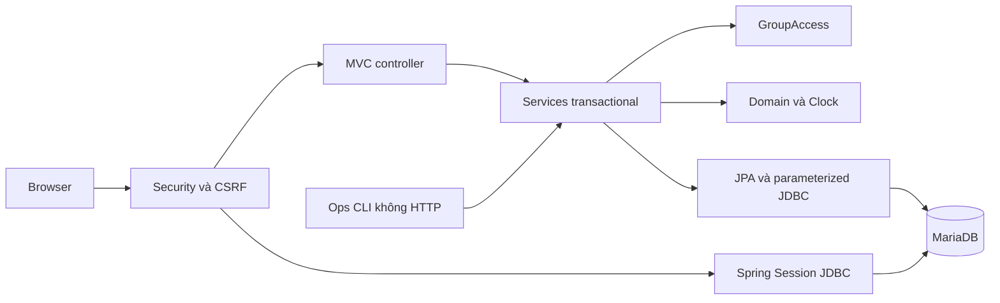

# Kiến trúc W1

Một Spring Boot render Thymeleaf phía máy chủ, một MariaDB. Chưa có cluster, worker hay mail. Mọi request kiểm tra danh tính/quyền tại máy chủ.

## Trách nhiệm

Domain độc lập framework. Task.create kiểm tra hạn tương lai; Task.restore khôi phục dữ liệu quá hạn hợp lệ. Task kiểm tra quyền và quy tắc DONE/reassignment, trả loại thay đổi để service ghi event. Clock được tiêm, test biên không sleep.

Controller lấy actor từ TrackerPrincipal. GroupMembershipFilter kiểm tra nhóm trước binding; GroupAccess là dịch vụ kiểm tra membership/Owner tập trung. Query task có cả id và groupId. Outsider 404; thành viên thiếu quyền 403. Ẩn nút không thay kiểm tra máy chủ.

WorkService tạo nhóm+Owner, task+event trong transaction. Form gửi expectedVersion và JPA @Version chặn hai transaction cùng qua precheck. Transaction thua rollback cả event. Isolation READ_COMMITTED (D-16). Flyway V1…V3 quản lý schema; Hibernate validate, không tự sửa.

## Dữ liệu

| Bảng | Ràng buộc/vai trò |
|---|---|
| app_user | username unique chuẩn hóa, hash, enabled, must_change_password, version |
| project_group | owner_id canonical bắt buộc, FK user RESTRICT |
| group_member | unique(group,user), check role, generated owner_marker unique chặn hai OWNER |
| task | FK assignee/creator thuộc group_member đúng nhóm, status/completedAt/title check, version |
| task_event | actor, loại CREATED/UPDATED/REASSIGNED/STATUS_CHANGED, trạng thái/người/hạn trước-sau |
| invitation | token_hash unique, hạn, used/revoked, FK người dùng |
| SPRING_SESSION/ATTRIBUTES | framework quản lý phiên, hủy theo principal |
| flyway_schema_history | lịch sử migration |

FK nghiệp vụ RESTRICT; cascade chỉ ở session framework. Service tạo owner membership cùng nhóm; owner_id luôn bắt buộc. Không hỗ trợ sửa DB trực tiếp/chuyển Owner. Event không lưu bản sao toàn bộ tên/mô tả cũ, mật khẩu hay token.

## Xác thực và lời mời

Spring Security quản lý login/fixation. Principal giữ ID/username/version, credentials được erase trước serialization. AccountStateFilter kiểm tra enabled/version mỗi request. Argon2 dùng thư viện, không tự viết mật mã.

Token SecureRandom 32 byte, raw chỉ hiện một lần trong liên kết cho Owner; không flash/session/DB/log. DB chỉ SHA-256. Join kiểm tra đã là thành viên trước; atomic UPDATE unused/unrevoked/unexpired + INSERT member cùng transaction. Hết hạn khi now >= expiresAt. GET không tiêu thụ; POST+CSRF join. No-referrer và không analytics/CDN.

Rate limiter bộ nhớ đồng bộ, bounded 10.000 keys, theo IP và username; một instance, restart mất trạng thái. Không tin X-Forwarded-For mặc định. Không phải chống tấn công phân tán.

## HTTP/thời gian/vận hành

Post/Redirect/Get thành công; lỗi field 400 giữ dữ liệu; stale 409 giữ phần nhập và yêu cầu reload. POST có CSRF, không business DELETE. Template escape, CSP self không inline, assets cục bộ, body tối đa16 KB. Header prod được test request secure mô phỏng; TLS thật kiểm tra khi deploy.

UTC cho JVM/Hibernate/DB; DATETIME(6) microsecond; HTML datetime-local qua Asia/Ho_Chi_Minh. So hạn ở phút để giữ giây đã lưu khi không đổi phút. Overdue/soon tính lúc đọc, DONE không overdue.

Ops tắt web, cần console tương tác. Anonymize giữ PK/FK/task/event, không đảm bảo xóa PII trong free text/backup. Backup single-transaction; manifest cần dừng writes. Restore chỉ vào DB mới có prefix riêng, không tự xóa DB. Xem OPS.

Testcontainers dùng MariaDB thật. MockMvc qua filter/controller/template/JDBC nhưng không đo mạng/TLS/browser. Kết quả browser, đo tải và clone mới ghi riêng trong EVIDENCE.
