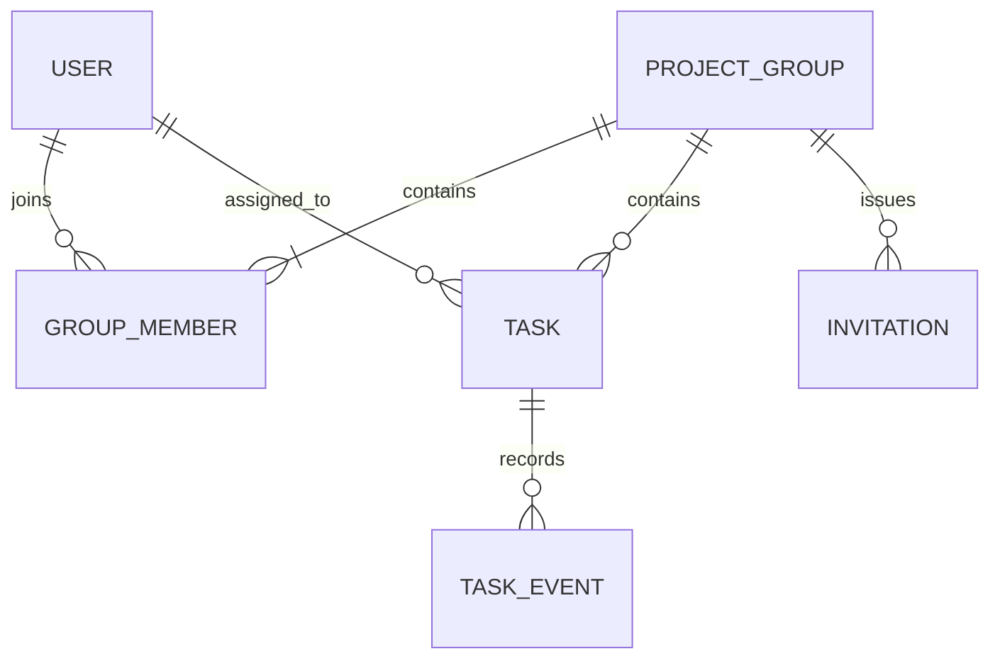

# Kế hoạch sản phẩm — Deadline Tracker

**Phiên bản:** 0.1 — bản đề xuất để triển khai và kiểm chứng với người dùng  
**Ngày:** 17/10/2026  
**Đối tượng:** nhóm đồ án sinh viên, khoảng 4–5 người mỗi nhóm  
**Người thực hiện:** một sinh viên, có AI hỗ trợ giải thích và review  
**Tài liệu liên quan:** [Backlog](BACKLOG.md) · [Lộ trình học và triển khai](LEARNING_ROADMAP.md)

## 1. Tóm tắt quyết định

Xây một ứng dụng web tiếng Việt giúp thành viên nhóm đồ án biết **việc gì cần làm, ai chịu trách nhiệm, hạn khi nào và đang ở trạng thái nào**. Trước khi lên web, dùng bản Java chạy trên máy để học và kiểm chứng nghiệp vụ.

Bản dùng thử đầu tiên phục vụ một nhóm 4–5 người. Phải kiểm tra cách ly dữ liệu với ít nhất một nhóm giả lập khác trước khi cho người thật sử dụng. Chưa có cam kết sản phẩm sẽ có người dùng thường xuyên; điều này phải được kiểm chứng trong giai đoạn dùng thử.

Hai kết quả cùng quan trọng:

1. **Sản phẩm:** nhóm dùng được luồng giao việc và cập nhật tiến độ, không mất dữ liệu khi khởi động lại, không truy cập chéo nhóm.
2. **Năng lực cá nhân:** người học giải thích được luồng dữ liệu, tự sửa được một quy tắc nghiệp vụ và kiểm chứng kết quả, thay vì chỉ chạy code AI viết.

Thứ tự ưu tiên khi thiếu thời gian: quyền truy cập và dữ liệu → luồng giao việc → độ dễ dùng → hình thức → tiện ích bổ sung.

## 2. Căn cứ, giả định và hiện trạng

### 2.1. Thông tin người dùng đã xác nhận

| Nội dung | Căn cứ |
|---|---|
| Học đầu năm 3; hiện thường dùng AI viết code | Trao đổi trong chat |
| Muốn chắc backend/AWS và làm sản phẩm có người dùng | Trao đổi trong chat |
| Làm một mình; ưu tiên miễn phí, tối đa 50.000 đồng/tuần | Trao đổi trong chat |
| Quy mô nhóm khoảng 4–5 người | Câu trả lời khi lập kế hoạch |
| Công việc có tên, người phụ trách, hạn, trạng thái; mô tả tùy chọn | Bài phân tích nghiệp vụ đã trả lời |
| Từ chối tên trống, người ngoài nhóm, hạn đã qua | Bài phân tích nghiệp vụ đã trả lời |
| Người được giao là người đổi trạng thái | Bài phân tích nghiệp vụ đã trả lời |
| Thông tin phải còn sau khi đóng/mở ứng dụng | Bài phân tích nghiệp vụ đã trả lời |

### 2.2. Các lựa chọn BA đề xuất, chưa phải quyết định của người dùng

- Nhóm có một chủ nhóm; những người còn lại là thành viên. Người tạo nhóm trở thành chủ nhóm.
- Thành viên được tạo việc; người tạo việc hoặc chủ nhóm được sửa thông tin/giao lại việc. Chỉ người đang được giao được đổi trạng thái, kể cả chủ nhóm cũng phải tuân theo.
- Một công việc có đúng một người phụ trách; một tài khoản có thể tham gia nhiều nhóm.
- Mời vào nhóm bằng liên kết dùng một lần, hết hạn sau 24 giờ; chưa gửi email tự động.
- Đăng nhập bằng tên tài khoản và mật khẩu trong bản đầu; không cần email để vận hành luồng cốt lõi.
- Giao diện web dùng danh sách và bộ lọc; bảng kéo thả để sau.
- Bản đầu chưa xóa công việc, xóa nhóm, loại thành viên hoặc chuyển chủ nhóm.
- Mốc “sắp đến hạn” là 24 giờ. Hiển thị giờ Việt Nam.

Các đề xuất này dùng để có một bản kế hoạch cụ thể. Nếu thay đổi, cập nhật quy tắc, quyền và tiêu chí nghiệm thu liên quan trước khi code tính năng đó. Không cần chốt mọi đề xuất để tiếp tục bài Java cơ bản.

### 2.3. Hiện trạng được đọc trực tiếp từ project

| Thành phần | Đã có | Khoảng cách đến bản dùng thử |
|---|---|---|
| `TaskStatus` | `TODO`, `IN_PROGRESS`, `DONE` | Chưa có luồng kiểm tra quyền |
| `Task` | Năm thuộc tính, constructor, getter, đổi trạng thái, kiểm tra đầu vào | Chưa có ID, nhóm, người tạo; người phụ trách vẫn là tên; chưa lưu dữ liệu |
| `Main` | Hai công việc mẫu, in thông tin, đổi trạng thái, ví dụ bắt lỗi | Chưa có thao tác nhập dữ liệu, danh sách nhóm hay giao diện web |
| Tài khoản/nhóm | Chưa có | Cần định danh, thành viên và quyền theo từng nhóm |
| Cơ sở dữ liệu/web/triển khai | Chưa có | Các mốc phát triển tiếp theo |

Đây là bản thực hành Java, chưa phải MVP. Mã ví dụ hiện tại không chứng minh được tính đúng đắn của phân quyền hoặc độ bền dữ liệu.

## 3. Vấn đề cần kiểm chứng

### 3.1. Giả thuyết vấn đề

Nhóm trao đổi qua chat nhưng khó tìm lại ai nhận việc gì, hạn nào đã đổi và việc nào bị chậm. Trưởng nhóm phải hỏi từng người để nắm tiến độ. Đây là giả thuyết, chưa phải kết quả phỏng vấn.

Giá trị dự kiến: một danh sách chung giúp cập nhật và kiểm tra nhanh, với số thao tác đủ ít để mọi người duy trì sử dụng. Cần tìm hiểu vì sao nhóm chưa giải quyết được vấn đề bằng bảng tính hoặc công cụ sẵn có.

### 3.2. Việc xác minh trước khi xây web

Phỏng vấn ngắn 3 thành viên, khoảng 10–15 phút/người. Hỏi về sự việc đã xảy ra thay vì chỉ hỏi họ có thích ý tưởng không:

1. Lần gần nhất nhóm quên hoặc trễ một đầu việc là khi nào? Hậu quả là gì?
2. Hiện nhóm ghi việc, giao người và sửa hạn ở đâu?
3. Khi muốn biết tiến độ, bạn làm gì và mất bao lâu?
4. Điều gì khiến nhóm bỏ một công cụ từng thử?
5. Bạn có đồng ý thử bản nhỏ trong hai tuần, với công việc thật của nhóm không?

Đầu ra: ghi chú có phân biệt lời người dùng và nhận định của mình; ít nhất một ví dụ vấn đề có thật; người đồng ý tham gia dùng thử. Không ghi “đã xác thực nhu cầu” nếu mới có phản hồi lịch sự.

**Điểm quyết định:** nếu vấn đề không đáng kể hoặc không có người thử, điều chỉnh bài toán trước khi đầu tư vào đăng nhập và giao diện. Phần Java vẫn có giá trị học tập.

### 3.3. Chỉ số thành công đề xuất

Đây là mục tiêu dùng thử, không phải số liệu đã đạt:

| Chỉ số | Mục tiêu ban đầu | Cách ghi nhận |
|---|---|---|
| Onboarding | Ít nhất 4 thành viên vào được cùng một nhóm | Buổi thử có quan sát |
| Việc thật | Ít nhất 10 công việc thật trong hai tuần | Đếm công việc do nhóm tạo, bỏ dữ liệu demo |
| Sử dụng độc lập | Ít nhất 3 người tự tạo/cập nhật việc trong hai tuần | Nhật ký thao tác tối thiểu và phỏng vấn |
| Dễ dùng | Thành viên tự tìm được việc mình và cập nhật trạng thái trong 2 phút | Quan sát sau khi đã đăng nhập; ghi rõ có trợ giúp hay không |
| Giá trị | Ít nhất 3 người muốn tiếp tục dùng và nêu được lý do cụ thể | Phỏng vấn cuối đợt; ghi cả lý do từ chối |
| Chất lượng | Không còn lỗi mất dữ liệu hoặc truy cập chéo nhóm đã biết | Nghiệm thu và nhật ký lỗi |

Không kết luận “giảm trễ hạn” sau một đợt thử nhỏ vì chưa đủ dữ liệu so sánh.

## 4. Người dùng và quyền

### 4.1. Vai trò

- **Chủ nhóm (Owner):** tạo nhóm, mời thành viên, theo dõi việc và điều chỉnh phân công.
- **Thành viên (Member):** xem việc trong nhóm, tạo việc, cập nhật việc được giao.
- **Người ngoài nhóm:** có thể có tài khoản nhưng không được đọc hoặc thao tác dữ liệu nhóm.
- **Người vận hành:** người phát triển ứng dụng, lo triển khai và hỗ trợ đợt thử; chưa xây màn hình quản trị toàn hệ thống.

Vai trò thuộc về quan hệ tài khoản–nhóm: một người có thể là chủ nhóm A nhưng chỉ là thành viên nhóm B. Chủ nhóm cũng là một thành viên và có thể nhận việc.

### 4.2. Ma trận quyền đề xuất

| Hành động | Chủ nhóm | Thành viên | Ngoài nhóm |
|---|---|---|---|
| Xem nhóm, thành viên, công việc | Có | Có | Không |
| Tạo công việc, giao cho thành viên trong nhóm | Có | Có | Không |
| Sửa tên, mô tả công việc | Mọi việc trong nhóm | Chỉ việc mình tạo | Không |
| Sửa hạn, đổi người phụ trách | Mọi việc chưa `DONE` | Chỉ việc mình tạo và chưa `DONE` | Không |
| Chủ động đổi trạng thái | Chỉ khi đang được giao việc | Chỉ khi đang được giao việc | Không |
| Tạo/thu hồi lời mời | Có | Không | Không |
| Đổi tên/mô tả nhóm | Có | Không | Không |
| Tự tạo nhóm mới | Có, với tư cách tài khoản đã đăng nhập | Có, với tư cách tài khoản đã đăng nhập | Có, sau khi đăng nhập |

“Mọi việc” luôn giới hạn trong đúng nhóm. Có quyền sửa thông tin không đồng nghĩa có quyền đổi trạng thái.

Hai trường hợp cần phân biệt: hệ thống tự đặt lại `TODO` khi giao việc cho người khác theo BR-09 là hệ quả của thao tác giao lại hợp lệ, không phải quyền tự chọn trạng thái của người giao. Người cầm lời mời hợp lệ được xem tên nhóm/người mời để xác nhận, nhưng chưa được xem thành viên hoặc công việc trước khi gia nhập.

## 5. Phạm vi theo phiên bản

### 5.1. C0 — bản học nghiệp vụ trên máy

- Mô hình tài khoản giả lập, nhóm, thành viên và công việc bằng Java.
- Danh sách trong bộ nhớ; nhập/chọn thao tác qua console khi đã học vòng lặp.
- Kiểm tra thành viên và quyền theo người thao tác giả lập.
- Danh sách việc, trạng thái, sắp đến hạn và quá hạn.

C0 là bài tập. Việc chọn tên hoặc ID người thao tác trong console không phải đăng nhập thật. Không dùng C0 để phục vụ nhóm qua internet.

### 5.2. D1 — lưu dữ liệu

- Tài khoản, nhóm, thành viên và công việc có ID ổn định.
- Lưu dữ liệu vào MariaDB; đọc lại sau khi tắt/mở chương trình.
- Ràng buộc quan hệ và cập nhật nhất quán; thử sao lưu/khôi phục trên dữ liệu thử.

D1 vẫn là mốc nội bộ, chưa đủ cho dùng thử web.

### 5.3. W1 — MVP web cho nhóm dùng thử

| Nhóm chức năng | Bao gồm |
|---|---|
| Tài khoản | Đăng ký, đăng nhập, đăng xuất, đổi mật khẩu khi đang đăng nhập |
| Nhóm | Tạo nhóm, danh sách nhóm của tôi, xem thành viên, sửa tên/mô tả nhóm |
| Lời mời | Chủ nhóm tạo/thu hồi liên kết; người được mời đăng nhập và xác nhận tham gia |
| Công việc | Tạo, xem chi tiết, sửa thông tin theo quyền, giao lại việc theo quy tắc |
| Tiến độ | Người được giao đổi trạng thái; mở lại việc đã hoàn thành |
| Theo dõi | Danh sách, lọc theo người/trạng thái/thời hạn, số việc và tỷ lệ hoàn thành |
| Độ tin cậy | Lưu dữ liệu, kiểm tra quyền phía máy chủ, chống ghi đè thay đổi cũ, ghi vết thay đổi chính |
| Vận hành | HTTPS khi đưa lên mạng, nhật ký lỗi, sao lưu/khôi phục, hướng dẫn hỗ trợ |

“Theo dõi hạn” trong W1 là nhãn và bộ lọc trên màn hình. Chưa có gửi nhắc hạn chủ động.

### 5.4. W1.1 — chỉ chọn sau phản hồi dùng thử

- Nhắc hạn qua một kênh; phải thống nhất người nhận, thời điểm, chống gửi trùng và chi phí trước khi làm.
- Bình luận, lịch sử thay đổi hiển thị cho người dùng.
- Lưu trữ/khôi phục công việc và nhóm; quản lý rời nhóm/loại thành viên/chuyển chủ nhóm.
- Tìm kiếm từ khóa, xuất CSV, chế độ bảng Kanban.

### 5.5. Ngoài phạm vi hiện tại

AI chia việc/chấm đóng góp, chat thời gian thực, gọi video, ứng dụng di động riêng, thanh toán, nhiều người phụ trách một việc, công việc lặp, phụ thuộc giữa việc, chấm điểm học tập, file đính kèm, đồng bộ lịch, tích hợp LMS, kiến trúc microservices.

Không tự thêm các mục này chỉ vì AI có thể viết nhanh. Mọi yêu cầu mới phải nêu người cần, tình huống sử dụng, giá trị, chi phí và phần nào sẽ bị lùi.

## 6. Luồng nghiệp vụ chính

### UC-01 — Đăng ký và vào ứng dụng

**Đầu vào:** tên tài khoản, tên hiển thị, mật khẩu. **Kết quả:** tài khoản hợp lệ có thể đăng nhập.

1. Người dùng điền thông tin; hệ thống kiểm tra định dạng và tên tài khoản trùng.
2. Lưu mật khẩu dưới dạng băm bằng thư viện bảo mật phù hợp, không lưu mật khẩu gốc.
3. Người dùng đăng nhập và thấy các nhóm mình tham gia; tài khoản mới thấy trạng thái chưa có nhóm.
4. Đăng xuất kết thúc phiên. Đổi mật khẩu yêu cầu mật khẩu hiện tại và kết thúc các phiên cũ.

**Ngoại lệ:** thông tin sai giữ lại dữ liệu không nhạy cảm đã nhập; đăng nhập thất bại dùng thông báo chung; quá nhiều lần thử bị giới hạn. Không tự đăng nhập với tên người khác bằng tham số gửi từ giao diện.

**Giới hạn dùng thử:** chưa có quên mật khẩu tự phục vụ. Người vận hành chỉ hỗ trợ reset sau khi xác nhận trực tiếp đúng người tham gia thử, hủy các phiên cũ và yêu cầu đổi mật khẩu cấp tạm trước khi tiếp tục thao tác. Quy trình hỗ trợ phải thử trước khi dùng thật; không công khai bản này như sản phẩm đã hoàn chỉnh cho người lạ.

### UC-02 — Tạo nhóm và mời thành viên

1. Người đã đăng nhập nhập tên nhóm, mô tả tùy chọn.
2. Hệ thống tạo nhóm và tư cách chủ nhóm trong cùng một giao dịch.
3. Chủ nhóm tạo liên kết mời và chia sẻ qua kênh đang dùng.
4. Người nhận đăng nhập, xem tên nhóm rồi xác nhận tham gia.
5. Hệ thống kiểm tra lời mời còn hiệu lực và thêm thành viên đúng một lần.

**Ngoại lệ:** lời mời hết hạn/thu hồi/đã dùng bị từ chối; tài khoản đã là thành viên được báo “Bạn đã ở trong nhóm” và không tạo bản ghi trùng. Hai người dùng một lời mời cùng lúc chỉ một người gia nhập thành công. Đăng xuất hoặc chưa đăng nhập không làm tiêu thụ lời mời.

### UC-03 — Tạo và giao công việc

1. Thành viên mở nhóm và chọn tạo công việc.
2. Nhập tên, mô tả tùy chọn, chọn một thành viên, chọn ngày giờ hạn nộp.
3. Hệ thống kiểm tra quyền trong nhóm và toàn bộ dữ liệu ở thời điểm lưu.
4. Tạo công việc `TODO`, lưu người tạo và người phụ trách bằng ID, rồi hiển thị trong danh sách.

**Ngoại lệ:** tên trống, người phụ trách không thuộc nhóm hoặc hạn không ở tương lai bị từ chối; dữ liệu hợp lệ đã nhập được giữ lại. Lưu thất bại không tạo công việc dở dang.

### UC-04 — Cập nhật tiến độ

1. Người được giao mở công việc và chọn một trạng thái hợp lệ.
2. Hệ thống xác định người thao tác từ phiên đăng nhập, đọc quyền và phiên bản dữ liệu hiện tại.
3. Nếu hợp lệ, cập nhật trạng thái cùng thông tin thay đổi.
4. Danh sách và số liệu tiến độ phản ánh kết quả sau khi tải lại.

**Ngoại lệ:** người khác thao tác bị từ chối, kể cả chủ nhóm không được giao. Nếu việc vừa được giao lại hoặc sửa bởi người khác, thông báo dữ liệu đã đổi và yêu cầu tải lại; không âm thầm ghi đè.

### UC-05 — Điều chỉnh thông tin và giao lại việc

1. Người tạo việc hoặc chủ nhóm mở chỉnh sửa.
2. Sửa tên/mô tả; với việc chưa hoàn thành có thể sửa hạn hoặc người phụ trách.
3. Hệ thống kiểm tra quyền, dữ liệu và phiên bản trước khi lưu.
4. Đổi người phụ trách sang người khác đặt trạng thái lại `TODO`; người cũ mất quyền đổi trạng thái ngay khi thay đổi có hiệu lực.

**Ngoại lệ:** sửa mô tả của việc đã quá hạn vẫn được phép mà không buộc đổi hạn. Nếu đổi hạn, hạn mới phải ở tương lai. Việc `DONE` phải được chính người phụ trách mở lại trước khi sửa hạn hoặc giao lại.

### UC-06 — Xem việc và hạn

Thành viên xem toàn bộ việc trong nhóm, lọc “của tôi”, người phụ trách, trạng thái, “sắp đến hạn” hoặc “quá hạn”. Các bộ lọc kết hợp theo điều kiện đồng thời. Mặc định sắp theo hạn tăng dần, cùng hạn thì theo ID; chưa cần kéo thả.

Danh sách trống phân biệt “nhóm chưa có việc” và “không có việc khớp bộ lọc”. Tổng quan nhóm luôn tính trên toàn bộ việc của nhóm, không đổi mẫu số theo bộ lọc; số kết quả lọc hiển thị riêng.

## 7. Quy tắc nghiệp vụ

Các giới hạn số trong bảng là đề xuất cho W1. Quy tắc người phụ trách/thuộc nhóm/tên/hạn kế thừa yêu cầu người dùng, phần diễn giải chi tiết vẫn cần review trước khi triển khai.

| ID | Quy tắc |
|---|---|
| BR-01 | Tên công việc bỏ khoảng trắng đầu/cuối, bắt buộc, dài 1–150 ký tự. Cho phép tên trùng vì hai việc có thể cùng tên. |
| BR-02 | Mô tả tùy chọn, tối đa 2.000 ký tự; `null` hoặc để trống đều được hiểu là chưa có mô tả. Nội dung là văn bản thuần. |
| BR-03 | Mỗi công việc thuộc đúng một nhóm và có đúng một người phụ trách đang thuộc nhóm đó. Không suy ra người dùng từ tên hiển thị. |
| BR-04 | Khi tạo việc hoặc thay đổi hạn, hạn mới phải lớn hơn thời gian máy chủ tại lúc xử lý. Chỉ sửa tên/mô tả không bắt hạn cũ phải ở tương lai. |
| BR-05 | Khi tạo việc thành công, trạng thái luôn là `TODO`; không tin trạng thái khởi tạo do trình duyệt tự gửi. |
| BR-06 | Chỉ người đang được giao và còn thuộc nhóm được chủ động chọn trạng thái mới. Chủ nhóm không được vượt quy tắc này. Reset tự động khi giao lại hợp lệ là trường hợp riêng theo BR-09. |
| BR-07 | Chấp nhận chuyển giữa bất kỳ hai trạng thái khác nhau trong ba giá trị; cho phép hoàn thành trực tiếp và mở lại. Gửi lại đúng trạng thái hiện tại không tạo thay đổi/lịch sử giả. |
| BR-08 | Người tạo việc hoặc chủ nhóm được sửa tên/mô tả; chỉ với việc chưa `DONE` mới được sửa hạn hoặc đổi người phụ trách. |
| BR-09 | Đổi sang một người phụ trách khác đặt trạng thái về `TODO`. Chọn lại cùng người không tự reset trạng thái. |
| BR-10 | Quá hạn là `status != DONE` và `now > dueAt`. Quá hạn là thông tin tính toán, không phải trạng thái thứ tư. |
| BR-11 | Sắp đến hạn là việc chưa `DONE` có hạn từ thời điểm hiện tại đến 24 giờ tiếp theo, gồm hai đầu mút. Việc đã quá hạn không thuộc nhóm này. |
| BR-12 | Hiển thị ngày giờ theo `Asia/Ho_Chi_Minh`; khi có web, lưu thời điểm thống nhất và chuyển đổi khi hiển thị. Máy chủ quyết định việc đã quá hạn, không dùng đồng hồ trình duyệt làm nguồn chuẩn. |
| BR-13 | Mọi truy cập nhóm/công việc đều phải kiểm tra tư cách thành viên ở máy chủ. Đổi ID trên URL hoặc nội dung yêu cầu không được truy cập chéo nhóm. |
| BR-14 | Người tạo nhóm là chủ nhóm duy nhất; mỗi cặp người dùng–nhóm chỉ có một tư cách thành viên. MVP chưa hỗ trợ rời nhóm, loại thành viên hoặc chuyển chủ nhóm. |
| BR-15 | Tên nhóm bắt buộc 1–100 ký tự sau khi bỏ khoảng trắng đầu/cuối; mô tả nhóm tùy chọn tối đa 1.000 ký tự. Tên nhóm không cần duy nhất. |
| BR-16 | Chỉ chủ nhóm tạo/thu hồi lời mời. Lời mời khó đoán, dùng một lần, hết hạn sau 24 giờ tính từ lúc tạo; hết hạn khi `now >= expiresAt`. |
| BR-17 | Chỉ đánh dấu lời mời đã dùng khi thêm thành viên thành công. Đã là thành viên thì không thêm trùng và không tiêu thụ lời mời. Một lời mời không được thêm hai người dù thao tác đồng thời. |
| BR-18 | Danh tính thao tác lấy từ phiên đăng nhập; bỏ qua/từ chối việc trình duyệt giả mạo `actorId`, `createdBy` hoặc vai trò. |
| BR-19 | Tỷ lệ hoàn thành = số việc `DONE` / tổng số việc của nhóm × 100, làm tròn đến số nguyên gần nhất; nhóm chưa có việc hiển thị 0% cùng thông báo chưa có việc. |
| BR-20 | Chuyển sang `DONE` ghi `completedAt`; mở lại xóa mốc hoàn thành hiện tại. Không suy ra thời điểm hoàn thành từ lần sửa mô tả. |
| BR-21 | Cập nhật trạng thái/thông tin và bản ghi thay đổi chính phải cùng thành công hoặc cùng thất bại. Xung đột phiên bản bị từ chối, không âm thầm ghi đè. |
| BR-22 | W1 không có xóa công việc/nhóm. Nếu người dùng cần xử lý việc tạo nhầm, ghi nhận để ưu tiên chức năng lưu trữ; không tự xóa dữ liệu của họ bằng thao tác vận hành thường ngày. |
| BR-23 | Tên tài khoản dài 3–30 ký tự, gồm chữ Latin thường, số, dấu chấm/gạch dưới/gạch ngang; chuẩn hóa chữ thường và phải duy nhất. Tên hiển thị 1–80 ký tự, có thể trùng và dùng tiếng Việt. |
| BR-24 | Mật khẩu đề xuất 15–128 ký tự vì MVP chưa có MFA; cho phép khoảng trắng, không tự cắt/strip mật khẩu. Chỉ lưu bản băm; đổi/reset mật khẩu hủy phiên cũ. |

Ví dụ phân biệt trạng thái và thời hạn:

| Trạng thái | Hạn so với hiện tại | Kết quả hiển thị |
|---|---|---|
| `TODO` | Còn 2 ngày | Chưa làm |
| `IN_PROGRESS` | Còn 4 giờ | Đang làm · Sắp đến hạn |
| `TODO` | Đã qua 1 giờ | Chưa làm · Quá hạn |
| `DONE` | Đã qua 1 ngày | Hoàn thành; không nằm trong danh sách việc đang quá hạn |

## 8. Mô hình dữ liệu nghiệp vụ

Đây là mô hình khái niệm, chưa phải schema SQL hoặc yêu cầu tạo tất cả class ngay lập tức.

| Đối tượng | Thông tin chính | Quan hệ/ràng buộc |
|---|---|---|
| User | ID, username, displayName, passwordHash, createdAt, thông tin bắt buộc đổi mật khẩu sau reset | username duy nhất; không lưu mật khẩu gốc |
| Group | ID, name, description, createdAt | Có đúng một Owner qua GroupMember |
| GroupMember | groupId, userId, role, joinedAt | Duy nhất `(groupId, userId)`; role là OWNER hoặc MEMBER |
| Task | ID, groupId, title, description, assigneeId, createdBy, dueAt, status, completedAt, createdAt, updatedAt, version | Người tạo/người phụ trách thuộc nhóm; ID không đổi theo tên |
| Invitation | ID, groupId, tokenHash, createdBy, createdAt, expiresAt, usedAt, usedBy, revokedAt | Không lưu token rõ trong nhật ký; sử dụng/thu hồi nhất quán |
| TaskEvent | ID, taskId, actorId, eventType, changedAt, thay đổi cần thiết về trạng thái/hạn/người phụ trách | Ghi vết tối thiểu ở máy chủ; màn hình xem lịch sử để W1.1 |

Tên `PROJECT_GROUP` trong sơ đồ giúp tránh nhầm với từ khóa SQL; tên bảng cụ thể quyết định ở mốc dữ liệu. Quan hệ “người tạo công việc” và người tạo/dùng lời mời cũng tham chiếu User dù được lược khỏi sơ đồ để dễ đọc.

### Khoảng cách cần xử lý từ code hiện có

1. Thay `assigneeName` bằng tham chiếu/ID người dùng khi đã có User và Group. Hai người có thể cùng tên.
2. Bổ sung nhóm và người tạo; không nhận danh tính người thao tác một cách đáng tin từ giao diện.
3. Các thuộc tính đang `final` sẽ cần cách cập nhật có kiểm soát để hỗ trợ sửa việc.
4. Tách kiểm tra “hạn phải ở tương lai” khi **tạo/đổi hạn** khỏi việc **nạp dữ liệu cũ**. Nếu cứ gọi constructor hiện tại để nạp một việc đã quá hạn từ DB, nó sẽ bị từ chối sai.
5. Tách nơi điều phối nghiệp vụ khỏi `Main`; web sau này gọi lại cùng nghiệp vụ, không chép một bản kiểm tra khác vào giao diện.

## 9. Màn hình và hành vi cần có

| Màn hình | Nội dung/hành động | Trạng thái phải thiết kế |
|---|---|---|
| Đăng nhập/đăng ký | Tên tài khoản, mật khẩu; tên hiển thị khi đăng ký | Sai dữ liệu, sai đăng nhập, trùng tài khoản, bị giới hạn thử |
| Nhóm của tôi | Tên nhóm, vai trò, tạo nhóm, mở nhóm | Chưa có nhóm, đang tải, lỗi tải |
| Trang nhóm | Thành viên, tổng quan, danh sách công việc, bộ lọc, tạo việc | Chưa có việc, không khớp bộ lọc, lỗi, không có quyền |
| Chi tiết công việc | Đầy đủ thông tin, đổi trạng thái hoặc sửa theo quyền | Đã quá hạn, thay đổi đã cũ, không còn quyền, lưu thất bại |
| Tạo/sửa công việc | Tên, mô tả, chọn người, ngày giờ hạn | Lỗi tại từng trường, đang lưu, thành công; không mất dữ liệu khi lỗi |
| Tham gia nhóm | Tên nhóm, xác nhận tham gia | Chưa đăng nhập, đã là thành viên, lời mời không dùng được |
| Thiết lập nhóm | Tên/mô tả; tạo/thu hồi lời mời | Chỉ Owner, hết hạn, sao chép liên kết thành công |
| Đổi mật khẩu | Mật khẩu hiện tại/mới/xác nhận | Sai mật khẩu hiện tại, mật khẩu mới không hợp lệ; phiên cũ bị hủy |

Yêu cầu trải nghiệm: dùng tiếng Việt; ngày giờ ghi rõ giờ Việt Nam; trạng thái có chữ kèm màu; lỗi nói được cách sửa; nút bị ẩn/khóa để dễ dùng nhưng máy chủ vẫn phải tự kiểm tra quyền.

## 10. Yêu cầu chất lượng

| ID | Yêu cầu và cách xác minh |
|---|---|
| NFR-01 | Kiểm tra quyền phía máy chủ cho từng thao tác và từng đối tượng. Thử sửa ID nhóm/task và giả mạo người thao tác; dữ liệu không được lộ hoặc đổi. |
| NFR-02 | Lưu dữ liệu sau khi khởi động lại; thao tác ghi quan trọng có giao dịch; không tạo quan hệ thành viên trùng hoặc bản ghi dở dang. |
| NFR-03 | Mật khẩu dùng thư viện băm phù hợp; phiên đăng nhập do framework quản lý. Khi lên mạng dùng HTTPS, cookie phù hợp, bảo vệ CSRF cho thao tác thay đổi dữ liệu; giới hạn thử đăng nhập/đăng ký. Không ghi mật khẩu, session hoặc token mời vào log. |
| NFR-04 | Với dữ liệu thử 3 nhóm × 5 người × 200 việc và 5 người thao tác đồng thời, mục tiêu 95% yêu cầu xem/lưu dưới 2 giây tại máy chủ đã khởi động ổn định. Ghi rõ môi trường, đo ít nhất 100 yêu cầu đại diện; tách thời gian khởi động nguội, không tuyên bố SLA. |
| NFR-05 | Giao diện dùng được trên màn hình rộng khoảng 360 px và máy tính; trường nhập có nhãn; thao tác chính dùng bàn phím được; màu không phải dấu hiệu duy nhất. |
| NFR-06 | Mục tiêu dùng thử: sao lưu mỗi ngày có sử dụng; chỉ tuyên bố khả năng mất tối đa khoảng 24 giờ dữ liệu khi lịch sao lưu thực sự chạy và được kiểm tra. Thử phục hồi dữ liệu mẫu trước pilot; mục tiêu phục hồi trong một buổi hỗ trợ, tối đa 4 giờ sau khi người vận hành bắt đầu xử lý. Không cam kết hỗ trợ 24/7. |
| NFR-07 | Lỗi có thông báo dễ hiểu và mã tham chiếu; log đủ tìm nguyên nhân nhưng không chứa bí mật. Lỗi hệ thống không hiển thị stack trace cho người dùng. |
| NFR-08 | Có hướng dẫn cài/chạy, schema/migration, dữ liệu mẫu không nhạy cảm, kiểm tra hồi quy nghiệp vụ/quyền và tài liệu triển khai/khôi phục. Một người khác có thể làm theo để chạy bản mẫu. |

- **SEC-05** Mật khẩu theo BR-24, không strip, chỉ lưu bản băm. Mật khẩu, token và ID phiên không xuất hiện trong log (test quét log). DB không lưu mật khẩu hay token lời mời thô (chỉ hash). Ngoại lệ có chủ đích theo D-25: (a) Spring Session JDBC lưu ID phiên và thuộc tính phiên, gồm CSRF token, trong bảng SPRING_SESSION*; (b) cookie phiên và CSRF token do framework phát cho browser; (c) token lời mời thô chỉ xuất hiện một lần trong phản hồi phân phối cho Owner; (d) mật khẩu tạm chỉ hiện trên console ops, không qua web. Không ngoại lệ nào áp dụng cho log.

Nguyên tắc kiểm tra quyền ở máy chủ, mặc định từ chối và kiểm tra từng yêu cầu tham khảo [OWASP Authorization Cheat Sheet](https://cheatsheetseries.owasp.org/cheatsheets/Authorization_Cheat_Sheet.html). Chính sách mật khẩu và xử lý đăng nhập tham khảo [OWASP Authentication Cheat Sheet](https://cheatsheetseries.owasp.org/cheatsheets/Authentication_Cheat_Sheet.html). Các con số về tải, dung lượng, thời gian sao lưu/phục hồi ở trên là mục tiêu nội bộ đề xuất, không phải kết quả đã đo.

## 11. Nghiệm thu bản dùng thử

Một tính năng “xong” khi đạt tiêu chí trong [Backlog](BACKLOG.md), có bằng chứng chạy và người học giải thích được. W1 chỉ mở pilot khi toàn bộ mục bắt buộc dưới đây đạt:

| ID | Kịch bản | Kết quả bắt buộc |
|---|---|---|
| UAT-01 | Tạo tài khoản, đăng nhập, đăng xuất; thử dùng lại phiên cũ | Luồng hoạt động; phiên đã đăng xuất không thao tác được |
| UAT-02 | Tạo nhóm và mời đủ 4–5 người | Đúng Owner/Member; không có thành viên trùng |
| UAT-03 | Dùng lời mời hết hạn/thu hồi/đã dùng; hai người dùng đồng thời | Từ chối đúng; không thêm hai người qua một lời mời |
| UAT-04 | Tạo việc hợp lệ và thử tên trống/người ngoài nhóm/hạn cũ | Việc hợp lệ là TODO; trường hợp sai không tạo dữ liệu |
| UAT-05 | Người được giao đổi trạng thái; người khác và Owner không được giao thử đổi | Chỉ người được giao đổi được; không thay đổi khi bị từ chối |
| UAT-06 | Chủ nhóm giao lại việc đang làm | Trở về TODO; người cũ không đổi được; người mới đổi được |
| UAT-07 | Đánh dấu hoàn thành rồi mở lại; gửi lại cùng trạng thái | completedAt đúng; thao tác lặp không tạo thay đổi giả |
| UAT-08 | Kiểm tra hạn ở trước/bằng/sau thời điểm cố định và mốc 24 giờ | Nhãn và bộ lọc đúng theo BR-10/BR-11; việc DONE không bị tính quá hạn |
| UAT-09 | Lưu việc, tắt/mở ứng dụng; nạp một việc nay đã quá hạn; sửa mô tả | Dữ liệu còn; nạp/sửa mô tả được mà không buộc đổi hạn |
| UAT-10 | Dùng tài khoản nhóm B sửa URL/body để đọc/sửa việc nhóm A | Không lộ dữ liệu; không có thay đổi |
| UAT-11 | Hai phiên cùng sửa một việc; một phiên đổi người phụ trách | Không âm thầm mất thay đổi; phiên cũ nhận thông báo tải lại |
| UAT-12 | Nhóm 0 việc, nhóm có việc DONE; bật nhiều bộ lọc | Không chia cho 0; tổng quan và kết quả lọc đúng định nghĩa |
| UAT-13 | Đổi/reset mật khẩu, thử dùng phiên cũ; thử xem log | Phiên cũ mất hiệu lực; không lộ bí mật |
| UAT-14 | Sao lưu, phục hồi vào DB thử rồi so sánh | Nhóm/thành viên/việc và quyền còn đúng; có ghi lại thao tác |

Không còn lỗi mức chặn pilot: mất dữ liệu, truy cập trái quyền, không đăng nhập được cho người thử, tạo/giao/cập nhật việc thất bại trong luồng bình thường. Lỗi hiển thị nhỏ được ghi nhận và có lịch sửa.

## 12. Lộ trình, công sức và ngân sách

Chi tiết từng bài học nằm ở [Lộ trình học](LEARNING_ROADMAP.md). Mốc tham chiếu là **12–16 tuần ở mức khoảng 15–20 giờ tập trung mỗi tuần**, bao gồm học, tự thử, sửa lỗi và dùng thử. Đây là khung ban đầu, không phải cam kết giao hàng; ước lượng lại sau hai tuần đầu dựa trên khả năng tự làm.

| Chặng | Khoảng thời gian tham chiếu | Đầu ra |
|---|---|---|
| M0–M1 | Tuần 1–3 | Kiểm chứng vấn đề; hiểu và tự viết được class, danh sách nhóm/thành viên |
| M2 | Tuần 4–5 | C0: giao việc, kiểm tra quyền giả lập, lọc deadline |
| M3 | Tuần 6–7 | D1: SQL và lưu dữ liệu đúng; đọc lại sau khi restart |
| M4–M5 | Tuần 8–11 | Backend web, đăng nhập, lời mời, giao diện tối thiểu và kiểm tra quyền |
| M6 | Tuần 12–13 | Đóng lỗi, thử triển khai/khôi phục và kiểm tra người dùng |
| M7 | Tuần 14–15 | Pilot hai tuần, sửa lỗi và đánh giá giá trị |
| Dự phòng | Tuần 16 hoặc điều chỉnh sớm hơn | Kiến thức mới, vướng triển khai hoặc sửa lỗi |

Không chạy theo lịch bằng cách giao toàn bộ phần khó cho AI. Nếu chậm, giảm tiện ích hoặc kéo dài thời gian; không bỏ kiểm tra quyền và dữ liệu để giữ ngày dự kiến.

### Ngân sách

- C0/D1 chạy trên máy cá nhân: mục tiêu không mua dịch vụ, không tính chi phí máy/điện/internet đã có.
- Trước pilot mới chọn nơi chạy dựa trên Java, DB bền vững, HTTPS, sao lưu và điều kiện dịch vụ lúc đó. Tối đa 50.000 đồng/tuần theo giới hạn người dùng; cần xem cả phí trả trước và thuế/phí liên quan, không tự quy đổi thành một gói tháng rồi vượt khả năng chi ngay.
- Chưa mua tên miền, email trả phí hoặc API AI. Không tự tạo tài nguyên tính phí từ bản kế hoạch này.
- Không mặc định free tier là nơi lưu dữ liệu lâu dài. Ví dụ, tài liệu [Render Free](https://render.com/docs/free) hiện ghi ứng dụng miễn phí ngủ sau 15 phút không hoạt động và PostgreSQL miễn phí hết hạn sau 30 ngày. Đây là thông tin tham khảo, không phải lựa chọn hosting cho MariaDB của dự án.
- Nếu không tìm được triển khai bền vững trong ngân sách: tiếp tục thử có quan sát trên môi trường do mình kiểm soát, ghi rõ chưa đạt pilot truy cập độc lập; không dùng giải pháp gây mất dữ liệu để tuyên bố đã hoàn thành.
- AWS là bài thực hành bổ sung sau khi luồng chính vững, hoặc môi trường triển khai nếu đã kiểm tra điều kiện và chi phí tài khoản thực tế. Chưa chốt dịch vụ, giá, credit hay khả năng miễn phí. Thử trên dữ liệu mẫu và có bước dọn tài nguyên.

## 13. Rủi ro và cách xử lý

| Rủi ro | Dấu hiệu | Cách giảm |
|---|---|---|
| Không có nhu cầu/không duy trì dùng | Chỉ mình developer tạo việc | Phỏng vấn trước web; thử với việc thật; dừng hoặc đổi hướng nếu giá trị thấp |
| AI làm thay phần hiểu | Chạy được nhưng không giải thích hay sửa được | Bài nhỏ, dự đoán kết quả, tự viết lại một luồng, review phần tự làm |
| Phạm vi phình | Thêm chat/AI/Kanban trước khi giao việc đúng | Đưa vào W1.1/backlog; muốn thêm phải nêu phần sẽ lùi |
| Lộ dữ liệu chéo nhóm | Chỉ ẩn nút ở giao diện | Kiểm tra máy chủ và UAT-10 trước pilot |
| Mất dữ liệu vì hosting miễn phí | DB hết hạn hoặc không có bản sao | Kiểm tra vòng đời dịch vụ; thử khôi phục; chưa đủ điều kiện thì chưa mở pilot độc lập |
| Thời gian thiếu thực tế | Nhiều giờ dùng AI nhưng ít giờ tự giải thích/sửa | Theo dõi số phiên học và đầu ra; ước lượng lại sau M1/M3 |
| Nhóm cần thay thành viên | Có người rời hoặc cần chuyển Owner | MVP chưa hỗ trợ; xác minh ngay khi phỏng vấn; nếu thường xảy ra thì đổi ưu tiên trước khi lên web |
| Sai lệch deadline | Mỗi máy hiển thị giờ khác nhau | Giờ hiển thị cố định, thời điểm máy chủ, thử các mốc biên |
| Hai người sửa cùng lúc | Trạng thái bị ghi đè sau khi giao lại việc | Kiểm tra phiên bản/quyền trên dữ liệu hiện tại trong cùng thao tác ghi |
| Quên mật khẩu trong pilot | Thành viên không vào được | Quy trình hỗ trợ xác nhận trực tiếp và reset có kiểm soát; quên mật khẩu tự phục vụ trước khi mở rộng cho người lạ |

## 14. Quản lý thay đổi và điểm cần xác nhận

Trước khi triển khai từng nhóm chức năng, xem lại quyết định liên quan; chưa cần dừng bài học Java để trả lời hết.

| ID | Câu hỏi/quyết định | Mặc định đề xuất | Hạn cần rõ |
|---|---|---|---|
| D-01 | Nhóm có chịu dùng thử với công việc thật không? | Chưa khẳng định | Trước đầu tư web |
| D-02 | Ai được tạo việc và giao cho người khác? | Mọi thành viên | Trước M2 |
| D-03 | Ai được sửa thông tin và giao lại? | Người tạo hoặc Owner | Trước M2 |
| D-04 | Có cần xóa/lưu trữ hoặc thay thành viên ngay không? | Để W1.1 | Sau phỏng vấn, trước M4 |
| D-05 | Nhắc hạn chủ động có bắt buộc cho người dùng đầu tiên không? | Chưa có trong W1 | Sau phỏng vấn |
| D-06 | Tên tài khoản hay email để đăng nhập? | Username, chưa xác minh email | Trước M4 |
| D-07 | Có chấp nhận hỗ trợ quên mật khẩu thủ công trong pilot nhỏ? | Có quy trình xác nhận trực tiếp | Trước mở pilot |
| D-08 | Có cần nhiều người cùng phụ trách một việc không? | Một người chịu trách nhiệm | Trước chốt dữ liệu |

Mỗi yêu cầu thay đổi ghi: vấn đề thật → người cần → phương án → ảnh hưởng quyền/dữ liệu/kiểm thử → công sức dự kiến → quyết định và lý do. Chủ sản phẩm là người học; AI hỗ trợ phân tích, không tự coi đề xuất là quyết định đã duyệt.

## 15. Hoàn thành dự án và bằng chứng cá nhân

Gói kết quả cần có: code chạy được; tài liệu cài/chạy; quy tắc và testcase; dữ liệu mẫu; bằng chứng kiểm tra quyền/khôi phục; ghi chú dùng thử thật; danh sách lỗi và thay đổi; demo ngắn; giải thích lựa chọn kỹ thuật và giới hạn còn lại.

Người học cần tự trình bày được bốn tình huống: tạo việc; người ngoài nhóm bị từ chối; việc trở thành quá hạn mà vẫn nạp lại được; hai người cùng sửa không làm mất thay đổi. Cần tự sửa ít nhất một quy tắc và kiểm chứng mà không nhận nguyên bản triển khai từ AI.

Chưa cần nhờ Claude để hoàn thiện kế hoạch này. Nếu muốn có ý kiến thứ hai, có thể nhờ review các mâu thuẫn/phạm vi bằng prompt ở cuối [Lộ trình học](LEARNING_ROADMAP.md); kết quả review là đầu vào để cân nhắc, không tự động mở rộng scope.
